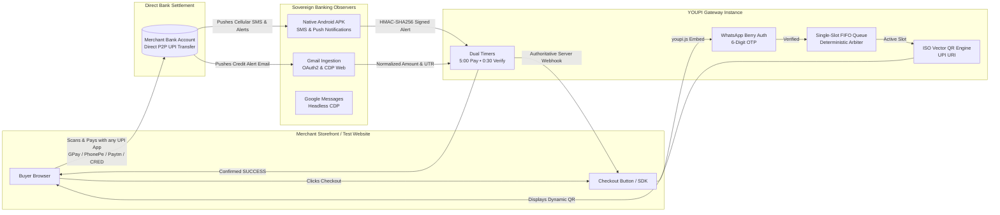

<div align="center">

```
██╗   ██╗ ██████╗ ██╗   ██╗██████╗ ██╗    ██████╗  ██████╗ 
╚██╗ ██╔╝██╔═══██╗██║   ██║██╔══██╗██║    ██╔══██╗██╔════╝ 
 ╚████╔╝ ██║   ██║██║   ██║██████╔╝██║    ██████╔╝██║  ███╗
  ╚██╔╝  ██║   ██║██║   ██║██╔═══╝ ██║    ██╔═══╝ ██║   ██║
   ██║   ╚██████╔╝╚██████╔╝██║     ██║    ██║     ╚██████╔╝
   ╚═╝    ╚═════╝  ╚═════╝  ╚═╝     ╚═╝    ╚═╝      ╚═════╝
```

#  YOUPI PG V2

### A Self-Hosted Sovereign UPI Payment Gateway for Merchants & Enterprise Web Applications


**Originally created by [Gaurav](https://github.com/gxurav1710). The project is now maintained by [Zenuxs](https://zenuxs.in).**
**0% Gateway Fees • Direct-to-Bank Settlement • WhatsApp Pre-Checkout OTP • Multi-Channel Observers • Production Multi-Domain Deployment**

> [!IMPORTANT]
> ## Research Project — Experimental Use Only
>
> **YOUPI PG V2 is an independent, experimental research and learning project. It is not represented as a certified, bank-approved, NPCI-approved, audited, or production-ready payment gateway.** It is published primarily for external developers to study, test, review, and contribute to.
>
> - **Appropriate scope:** local development, test environments, demos, learning, and carefully controlled experiments. Small projects or early-stage businesses may evaluate it only after independently assessing the risks and their legal/compliance obligations.
> - **Not for critical payments:** do not rely on it for essential, high-value, high-volume, time-sensitive, or business-critical transactions. Do not use it as the sole source of truth for payment confirmation.
> - **Conservative project testing limit:** for experiments, keep usage to **no more than 20 payment attempts/transactions per day per receiving account** unless you have verified the applicable bank, UPI app, and current NPCI rules and obtained any required approvals.
> - **No official affiliation:** this repository is not affiliated with, endorsed by, or sponsored by NPCI, RBI, any bank, or any UPI app.
> - **No compliance guarantee:** using this software does not itself authorise you to operate a payment aggregator, payment system, or other regulated service. Before accepting payments from customers or serving third-party merchants, seek qualified legal/compliance advice and confirm requirements with your bank/acquirer and the relevant authorities.
> - **Use test data where possible:** never commit bank alerts, customer information, OTPs, access tokens, API keys, webhook secrets, or other credentials. Use isolated test accounts and rotate any secret that may have been exposed.
> - **Verify every payment independently:** browser callbacks, screenshots, SMS/email parsing, and this software's status are not by themselves conclusive proof of settlement. Reconcile against the bank's official records.


<br/>

[](https://nodejs.org)
[](#)
[](#)
[](#)
[](#)
[](#)
[](#)
[](#)

<br/>

<p align="center">
  <a href="#-live-product-demos">Live Demos</a> •
  <a href="#-overview">Why YOUPI?</a> •
  <a href="#-architecture-at-a-glance">Architecture</a> •
  <a href="#-security--advanced-hardening-architecture">Security Hardening</a> •
  <a href="#-multi-domain--subdomain-deployment-guide-sabhi-pages-ko-domain-par-kaise-kare">Multi-Domain Deployment</a> •
  <a href="#-interactive-test-website--sandbox-playground-guide-test-website-and-testing">Test Website & Sandbox</a> •
  <a href="#-a-to-z-webhook-integration-manual-webhook-url-me-kya-dale-kaha-kya-step-by-step">A-to-Z Webhook Manual</a> •
  <a href="#-step-by-step-deployment--quickstart-guide-code-deploy-kaise-kare">Quickstart</a> •
  <a href="#-android-observer-apk-setup-guide-phone-me-download-aur-set-up-kaise-kare">Android Observer</a>
</p>

---

</div>

<br/>

##  Live Product Demos

See **YOUPI PG V2** live in action across Desktop and Mobile checkout flows:

|  Desktop Modal Flow |  Mobile Drawer & App Switcher |
| :---: | :---: |
| <br/><sub>*Full end-to-end checkout: One-script modal, WhatsApp OTP, dynamic vector QR & bank observation.*</sub> | <br/><sub>*Ultra-responsive bottom drawer with 1-tap deep-link intent for GPay, PhonePe, Paytm & CRED.*</sub> |
| • **Zero-JS One-Script Trigger**: Auto-binds to `[data-youpi-pay]`<br/>• **WhatsApp Pre-Checkout OTP**: Real-time 6-digit phone verification<br/>• **Dynamic Vector SVG QR**: Pure vector QR code with dual timers<br/>• **Experimental observer-based payment detection**: Instant credit via bank SMS/Gmail | • **Responsive Bottom Drawer**: Native app-feel mobile UI<br/>• **Direct UPI App Deep-Linking**: GPay, PhonePe, Paytm, CRED<br/>• **Real-Time Payment Polling**: Instant status reflection<br/>• **Counter Desk Modalities**: Configurable Cash & Card fallback |

<br/>

> **High-Definition 120FPS Raw Recordings**: [assets/Desktop.mp4](assets/Desktop.mp4) • [assets/Mobile.mp4](assets/Mobile.mp4)

<br/>

---

##  Overview

Traditional payment gateways (Razorpay, Cashfree, PayU, Stripe) lock your revenue into high fees, multi-day settlement delays, and sudden compliance freezes:

| Comparison Metric | Traditional Aggregators (Razorpay / Cashfree) |  YOUPI PG (Self-Hosted Sovereign) |
| :--- | :--- | :--- |
| **Transaction Fee** | **2.0% – 3.0% + 18% GST** per transaction | **0.0% (Zero Fees Forever)** |
| **Settlement Speed** | **T+2 to T+3 Business Days** (Holdbacks) | **Direct P2P bank transfer; instant timing via UPI** |
| **Control & Hosting** | Closed SaaS vendor lock-in | **100% Self-Hosted & Multi-Domain Ready** |
| **Customer Authentication** | SMS OTP (Costly SMS gateway bills, phone spoofing) | **WhatsApp OTP** (Zero spoofing, verified mobile) |
| **Payment Verification** | Aggregator proprietary webhooks | **Bank SMS & Gmail Alerts** parsed in real time |
| **Queue & Mismatch Prevention** | Aggregator pooled virtual accounts | **Invariant Single-Slot FIFO UPI Queue** |
| **Branding Control** | "Secured by Razorpay" badges mandatory | **100% White-Label** (Your brand, your domain, zero mentions) |
| **Offline Retail Till Desk** | Expensive add-ons / dedicated POS hardware | **Built-in POS Cash & Card at Till Billing Mode** |

<br/>

---

##  Architecture at a Glance

YOUPI PG pairs **pure vector SVG QR codes** with an **automated multi-channel banking observation mesh**:



<br/>

---

## 🔒 Security & Advanced Hardening Architecture

YOUPI PG V2 incorporates enterprise-grade security and financial integrity defenses across all microservices:

### 1. Control Panel (Control Center Supervisor) Bearer Authentication Guard
The Control Center Supervisor (`Port 8090`) manages host node processes, restarts services, and streams live system stdout/stderr logs.
- **Admin Bearer Token Enforcement**: All sensitive management endpoints (`/api/services/*`, `/api/logs/stream`) strictly enforce an `Authorization: Bearer <ADMIN_API_TOKEN>` header.
- **Constant-Time Cryptographic Comparison (`safeEqual`)**: Token validation uses `crypto.timingSafeEqual()` to eliminate timing side-channel attacks.
- **Query Parameter Credential Leaks Prevented**: Sensitive SSE log streams accept authorization through headers, preventing tokens from being logged in web server access logs, browser history, or Referer headers.

### 2. Strict HTTP Security Headers & Content Security Policy (CSP)
Every microservice (Control Center, Merchant Admin, Checkout Portal, Payment API, Test Store) emits hardened production HTTP response headers:
```http
X-Content-Type-Options: nosniff
X-Frame-Options: SAMEORIGIN
Referrer-Policy: strict-origin-when-cross-origin
Content-Security-Policy: default-src 'self'; img-src 'self' data: https:; style-src 'self' 'unsafe-inline'; script-src 'self' 'unsafe-inline'; frame-ancestors 'self'; base-uri 'none'; form-action 'self'; object-src 'none'
```

### 3. Anti-Replay & HMAC-SHA256 Payload Signature Verification
- All incoming observation alerts (Android APK, Gmail, SMS) and outbound Webhook dispatches are cryptographically signed using **HMAC-SHA256**.
- **Anti-Replay Timestamp Tolerance**: Webhooks and observation alerts carry a signed unix timestamp (`X-Gateway-Timestamp`). Payloads with timestamp drift $> 2$ hours are immediately rejected.
- **Delivery ID Deduplication (`X-Gateway-Delivery-Id`)**: Single-use delivery IDs are stored in memory/DB to ensure no payment confirmation can be replayed or processed twice.

### 4. Financial Minor Unit (Paise) Precision
- All monetary arithmetic is conducted using strictly bounded **64-bit integer minor units (Paise)**: ₹499.00 = `49900` paise. Floating-point rounding drift is mathematically impossible.

### 5. XSS & SQL Injection Defense
- Template rendering uses HTML escaping for all user/query parameters (`order_id`, `utr`, `amount`, `reason`).
- SQLite uses parameterized prepared statements across all package query layers.

<br/>

---

## 🌐 Multi-Domain & Subdomain Deployment Guide (Sabhi Pages Ko Domain Par Kaise Kare)

To make your payment infrastructure fully professional, secure, and white-labeled, you can host **every single microservice and page (including Control Panel)** on custom domain names or subdomains with **HTTPS / SSL Encryption**.

### Service & Domain Mapping Topology:

| Service Name | Default Port | Recommended Production Domain / Subdomain | Public Page Routes & Description |
| :--- | :---: | :--- | :--- |
| **Control Panel** | `8090` | `control.yourdomain.com` | `https://control.yourdomain.com/`<br/>`https://control.yourdomain.com/dashboard`<br/>*(Supervisor process panel, service status & live SSE log viewer)* |
| **Checkout Portal** | `7000` | `pay.yourdomain.com` | `https://pay.yourdomain.com/`<br/>`https://pay.yourdomain.com/checkout/{payment_id}`<br/>`https://pay.yourdomain.com/youpi.js`<br/>`https://pay.yourdomain.com/youpi-sms-gateway.apk`<br/>*(Customer drawer/modal, vector QR code & SDK endpoint)* |
| **Merchant Admin** | `6001` | `admin.yourdomain.com` | `https://admin.yourdomain.com/`<br/>`https://admin.yourdomain.com/till`<br/>*(Merchant operational dashboard, VPA manager & POS Till Dock)* |
| **Payment REST API** | `6100` | `api.yourdomain.com` | `https://api.yourdomain.com/`<br/>`https://api.yourdomain.com/health`<br/>`https://api.yourdomain.com/api/v1/checkout/{payment_id}/state`<br/>*(Core payment state engine, WhatsApp OTP & Webhook engine)* |
| **Test Website / Showcase** | `5000` | `store.yourdomain.com` | `https://store.yourdomain.com/`<br/>`https://store.yourdomain.com/wallet`<br/>`https://store.yourdomain.com/order-success`<br/>*(Interactive Test Website & Sandbox Playground)* |

<br/>

### Option 1: Nginx Reverse Proxy Configuration with Let's Encrypt SSL (Recommended)

Create `/etc/nginx/sites-available/youpi.conf` on your server:

```nginx
# 1. Checkout Portal (pay.yourdomain.com)
server {
    listen 80;
    server_name pay.yourdomain.com;
    return 301 https://$host$request_uri;
}

server {
    listen 443 ssl http2;
    server_name pay.yourdomain.com;

    ssl_certificate /etc/letsencrypt/live/pay.yourdomain.com/fullchain.pem;
    ssl_certificate_key /etc/letsencrypt/live/pay.yourdomain.com/privkey.pem;

    location / {
        proxy_pass http://127.0.0.1:7000;
        proxy_set_header Host $host;
        proxy_set_header X-Real-IP $remote_addr;
        proxy_set_header X-Forwarded-For $proxy_add_x_forwarded_for;
        proxy_set_header X-Forwarded-Proto $scheme;

        # WebSockets & SSE Support
        proxy_http_version 1.1;
        proxy_set_header Upgrade $http_upgrade;
        proxy_set_header Connection "upgrade";
    }
}

# 2. Control Panel Supervisor (control.yourdomain.com)
server {
    listen 80;
    server_name control.yourdomain.com;
    return 301 https://$host$request_uri;
}

server {
    listen 443 ssl http2;
    server_name control.yourdomain.com;

    ssl_certificate /etc/letsencrypt/live/control.yourdomain.com/fullchain.pem;
    ssl_certificate_key /etc/letsencrypt/live/control.yourdomain.com/privkey.pem;

    location / {
        proxy_pass http://127.0.0.1:8090;
        proxy_set_header Host $host;
        proxy_set_header X-Real-IP $remote_addr;
        proxy_set_header X-Forwarded-For $proxy_add_x_forwarded_for;
        proxy_set_header X-Forwarded-Proto $scheme;

        # SSE Log Stream Support
        proxy_http_version 1.1;
        proxy_set_header Connection '';
        proxy_buffering off;
        proxy_cache off;
    }
}

# 3. Merchant Admin Panel (admin.yourdomain.com)
server {
    listen 80;
    server_name admin.yourdomain.com;
    return 301 https://$host$request_uri;
}

server {
    listen 443 ssl http2;
    server_name admin.yourdomain.com;

    ssl_certificate /etc/letsencrypt/live/admin.yourdomain.com/fullchain.pem;
    ssl_certificate_key /etc/letsencrypt/live/admin.yourdomain.com/privkey.pem;

    location / {
        proxy_pass http://127.0.0.1:6001;
        proxy_set_header Host $host;
        proxy_set_header X-Real-IP $remote_addr;
        proxy_set_header X-Forwarded-For $proxy_add_x_forwarded_for;
        proxy_set_header X-Forwarded-Proto $scheme;
    }
}

# 4. Payment REST API (api.yourdomain.com)
server {
    listen 80;
    server_name api.yourdomain.com;
    return 301 https://$host$request_uri;
}

server {
    listen 443 ssl http2;
    server_name api.yourdomain.com;

    ssl_certificate /etc/letsencrypt/live/api.yourdomain.com/fullchain.pem;
    ssl_certificate_key /etc/letsencrypt/live/api.yourdomain.com/privkey.pem;

    location / {
        proxy_pass http://127.0.0.1:6100;
        proxy_set_header Host $host;
        proxy_set_header X-Real-IP $remote_addr;
        proxy_set_header X-Forwarded-For $proxy_add_x_forwarded_for;
        proxy_set_header X-Forwarded-Proto $scheme;
    }
}

# 5. Interactive Test Website (store.yourdomain.com)
server {
    listen 80;
    server_name store.yourdomain.com;
    return 301 https://$host$request_uri;
}

server {
    listen 443 ssl http2;
    server_name store.yourdomain.com;

    ssl_certificate /etc/letsencrypt/live/store.yourdomain.com/fullchain.pem;
    ssl_certificate_key /etc/letsencrypt/live/store.yourdomain.com/privkey.pem;

    location / {
        proxy_pass http://127.0.0.1:5000;
        proxy_set_header Host $host;
        proxy_set_header X-Real-IP $remote_addr;
        proxy_set_header X-Forwarded-For $proxy_add_x_forwarded_for;
        proxy_set_header X-Forwarded-Proto $scheme;
    }
}
```

Enable the site and obtain free SSL certificates using Certbot:
```bash
sudo ln -s /etc/nginx/sites-available/youpi.conf /etc/nginx/sites-enabled/
sudo certbot --nginx -d pay.yourdomain.com -d control.yourdomain.com -d admin.yourdomain.com -d api.yourdomain.com -d store.yourdomain.com
sudo nginx -t && sudo systemctl reload nginx
```

<br/>

### Option 2: Cloudflare Tunnel Configuration (`config.yml` — Zero Open Ports)

If using Cloudflare Tunnels to route domain traffic safely without opening inbound firewall ports:

```yaml
tunnel: <YOUR_TUNNEL_UUID>
credentials-file: /root/.cloudflared/<YOUR_TUNNEL_UUID>.json

ingress:
  - hostname: pay.yourdomain.com
    service: http://localhost:7000
  - hostname: control.yourdomain.com
    service: http://localhost:8090
  - hostname: admin.yourdomain.com
    service: http://localhost:6001
  - hostname: api.yourdomain.com
    service: http://localhost:6100
  - hostname: store.yourdomain.com
    service: http://localhost:5000
  - service: http_status:404
```

### Option 3: Production Environment Variables (`.env`) for Multi-Domain Setup

After binding your domains, update your `.env` file on the server:

```env
YOUPI_MODE=production
YOUPI_ALLOW_LOCALHOST_MODE=false

# Public Domain Endpoints
BASE_PAYMENT_API_URL=https://api.yourdomain.com
BASE_CHECKOUT_URL=https://pay.yourdomain.com
BASE_ADMIN_URL=https://admin.yourdomain.com
CONTROL_CENTER_URL=https://control.yourdomain.com
COIN_STORE_PUBLIC_URL=https://store.yourdomain.com
```

<br/>

---

## 🧪 Interactive Test Website & Sandbox Playground Guide (Test Website & Testing)

YOUPI PG V2 comes with a fully functional reference **Showcase Store & Sandbox Playground** (`apps/coin-wallet-store`) hosted at `http://localhost:5000` (or `https://store.yourdomain.com`).

### 1. How to Access and Run the Test Website:
- Start the server using `npm run dev` or `npm start`.
- Open your browser and navigate to:
  - **Local Test URL**: [`http://localhost:5000`](http://localhost:5000)
  - **Live Domain URL**: `https://store.yourdomain.com`

### 2. What You Can Test on the Sandbox Store:
1. **Coin Pack Purchase Flow**: Click on any coin pack (₹1.00 Starter Pack, ₹499.00 Gamer Pack, ₹999.00 Pro Pack) to launch the `youpi.js` modal.
2. **WhatsApp OTP Pre-Checkout Verification**: Test mobile number verification with real-time 6-digit WhatsApp OTP delivery.
3. **Dynamic Vector SVG QR Code**: Render dynamic UPI URI standard QR codes with live countdown timers ($5:00$ payment window + $0:30$ verification window).
4. **Developer Payment Simulator / Test Mode**:
   - In development/sandbox mode, you can trigger instant payment test completions without making real bank transfers.
   - Click **Simulate Payment Success** in Developer Tools / Test Bar to trigger instant payment credit!
5. **Real-Time Coin Wallet Ledger**: Verified payments instantly credit coins to the customer's wallet balance (`/wallet`) and record the transaction in the history ledger.

### 3. Testing Standardized Merchant Outcome Pages:
You can directly test and visually inspect all 5 standardized outcome pages served by the gateway:
- **Order Success**: `https://store.yourdomain.com/order-success?order_id=COIN-1001&utr=401234567890&amount=499.00`
- **Order Failed**: `https://store.yourdomain.com/order-failed?order_id=COIN-1001&reason=Payment%20Verification%20Timed%20Out`
- **Order Suspicious**: `https://store.yourdomain.com/order-suspicious?order_id=COIN-1001`
- **Order Expired**: `https://store.yourdomain.com/order-expired?order_id=COIN-1001`
- **Order Cancelled**: `https://store.yourdomain.com/order-cancelled?order_id=COIN-1001`

<br/>

---

## 🔔 A-to-Z Webhook Integration Manual (Webhook URL Me Kya Dale, Kaha, Kya Step-by-Step)

When a customer completes a UPI payment, YOUPI PG dispatches an authoritative **Server-to-Server Webhook HTTP POST** notification to your website backend.

### Step 1: Where to Configure Webhook URL in Merchant Admin
1. Open **Merchant Admin Dashboard** (`http://localhost:6001` or `https://admin.yourdomain.com`).
2. Go to **Settings / API Keys** in the navigation menu.
3. Locate the **Webhook URL** field:
   - **What to enter**: Enter your backend server's POST endpoint URL (e.g. `https://yourdomain.com/api/youpi-webhook`).
   - For local development testing, you can use local tunnel URLs (ngrok / Localtunnel) or test with the Showcase Store endpoint (`http://localhost:5000/api/webhook`).
4. Copy your **Webhook Secret** (e.g. `whsec_9876543210abcdef...`). Store this secret securely in your backend environment variables (`YOUPI_WEBHOOK_SECRET`).

<br/>

### Step 2: What Headers & Payload YOUPI PG Sends

Whenever a payment status updates (`SUCCESS`, `FAILED`, `EXPIRED`, `REFUNDED`), YOUPI PG dispatches an HTTP POST request with the following headers:

#### HTTP Request Headers Sent:
```http
POST /api/youpi-webhook HTTP/1.1
Host: yourdomain.com
Content-Type: application/json
X-Gateway-Signature: sha256=a1b2c3d4e5f67890123456789abcdef0123456789abcdef0123456789abcdef0
X-Gateway-Timestamp: 1711234567890
X-Gateway-Delivery-Id: del_9876543210123456
X-Gateway-Event: SUCCESS
```

#### JSON Request Body Payload:
```json
{
  "event": "SUCCESS",
  "paymentId": "pay_9876543210abcdef",
  "orderId": "ORDER-1001",
  "amount": "499.00",
  "amountPaise": 49900,
  "currency": "INR",
  "method": "UPI",
  "utr": "401234567890",
  "vpa": "mr.kumar.614@superyes",
  "customer": {
    "name": "Mohit",
    "email": "mohit@example.com",
    "phone": "9876543210"
  },
  "metadata": {
    "coins": 499,
    "packName": "Gamer Pack"
  },
  "timestamp": 1711234567890
}
```

<br/>

### Step 3: Webhook Verification Logic (Raw Body HMAC-SHA256)

> ⚠️ **CRITICAL SECURITY REQUIREMENT**: Always calculate the signature over the **RAW UNPARSED REQUEST BODY BYTES** combined with `X-Gateway-Timestamp` using your `YOUPI_WEBHOOK_SECRET`. Never parse JSON before validating the signature!

Signature string format: `rawBodyBytes + '.' + timestampHeader`

<br/>

### Step 4: Ready-to-Use Webhook Receiver Code Snippets (5 Languages)

##### 1. Node.js (Express)
```javascript
import crypto from 'node:crypto';
import express from 'express';

const app = express();

// Use express.raw to preserve raw unparsed body bytes
app.post('/api/youpi-webhook', express.raw({ type: 'application/json' }), (req, res) => {
  const signature = req.headers['x-gateway-signature'] || '';
  const timestamp = req.headers['x-gateway-timestamp'] || '';
  const deliveryId = req.headers['x-gateway-delivery-id'] || '';
  const secret = process.env.YOUPI_WEBHOOK_SECRET;

  // 1. Validate Timestamp Drift (< 2 hours)
  const skew = Math.abs(Date.now() - Number(timestamp));
  if (skew > 2 * 60 * 60 * 1000) {
    return res.status(401).json({ error: 'Webhook timestamp expired' });
  }

  // 2. Compute Expected HMAC Signature over Raw Body
  const signedPayload = req.body.toString('utf8') + '.' + timestamp;
  const expected = 'sha256=' + crypto.createHmac('sha256', secret).update(signedPayload).digest('hex');

  // 3. Constant-time Signature Comparison
  if (signature.length !== expected.length || !crypto.timingSafeEqual(Buffer.from(signature), Buffer.from(expected))) {
    return res.status(401).json({ error: 'Invalid webhook signature' });
  }

  // 4. Parse JSON Payload & Fulfill Order
  const payload = JSON.parse(req.body.toString('utf8'));

  if (payload.event === 'SUCCESS' && payload.method === 'UPI') {
    console.log(`✅ Order ${payload.orderId} Paid! Amount: ₹${payload.amount}, Bank UTR: ${payload.utr}`);
    // Update your database: mark order as PAID
  }

  // 5. Respond with HTTP 200 OK
  res.status(200).json({ received: true });
});
```

##### 2. Python (FastAPI)
```python
import hmac, hashlib, json, time
from fastapi import FastAPI, Request, HTTPException

app = FastAPI()

@app.post("/api/youpi-webhook")
async def youpi_webhook(request: Request):
    raw_body = await request.body()
    signature = request.headers.get("X-Gateway-Signature", "")
    timestamp = request.headers.get("X-Gateway-Timestamp", "")
    secret = request.app.state.webhook_secret.encode("utf-8")

    # 1. Timestamp drift check
    if abs(time.time() * 1000 - float(timestamp or 0)) > 7200000:
        raise HTTPException(status_code=401, detail="Timestamp expired")

    # 2. Verify HMAC Signature
    signed_payload = raw_body + b"." + timestamp.encode("utf-8")
    expected = "sha256=" + hmac.new(secret, signed_payload, hashlib.sha256).hexdigest()

    if not hmac.compare_digest(signature, expected):
        raise HTTPException(status_code=401, detail="Invalid signature")

    payload = json.loads(raw_body.decode("utf-8"))
    if payload.get("event") == "SUCCESS" and payload.get("method") == "UPI":
        order_id = payload.get("orderId")
        utr = payload.get("utr")
        # Mark order paid in database

    return {"received": True}
```

##### 3. PHP
```php
<?php
$rawPayload = file_get_contents('php://input');
$signature = $_SERVER['HTTP_X_GATEWAY_SIGNATURE'] ?? '';
$timestamp = $_SERVER['HTTP_X_GATEWAY_TIMESTAMP'] ?? '';
$secret = getenv('YOUPI_WEBHOOK_SECRET');

// Verify Timestamp Drift (< 2 hours)
if (abs((time() * 1000) - (float)$timestamp) > 7200000) {
    http_response_code(401);
    exit(json_encode(['error' => 'Timestamp expired']));
}

// Compute Expected HMAC
$signedPayload = $rawPayload . '.' . $timestamp;
$expected = 'sha256=' . hash_hmac('sha256', $signedPayload, $secret);

if (!hash_equals($expected, $signature)) {
    http_response_code(401);
    exit(json_encode(['error' => 'Invalid signature']));
}

$payload = json_decode($rawPayload, true);
if (($payload['event'] ?? '') === 'SUCCESS' && ($payload['method'] ?? '') === 'UPI') {
    $orderId = $payload['orderId'];
    $utr = $payload['utr'];
    // Fulfill order in DB
}

http_response_code(200);
echo json_encode(['received' => true]);
?>
```

##### 4. Go (`net/http`)
```go
package main

import (
	"crypto/hmac"
	"crypto/sha256"
	"encoding/hex"
	"encoding/json"
	"io"
	"net/http"
	"os"
	"strconv"
	"time"
)

func youpiWebhookHandler(w http.ResponseWriter, r *http.Request) {
	rawBody, err := io.ReadAll(r.Body)
	if err != nil {
		http.Error(w, "Cannot read body", http.StatusBadRequest)
		return
	}
	defer r.Body.Close()

	signature := r.Header.Get("X-Gateway-Signature")
	timestamp := r.Header.Get("X-Gateway-Timestamp")
	secret := []byte(os.Getenv("YOUPI_WEBHOOK_SECRET"))

	// Verify timestamp
	ts, _ := strconv.ParseInt(timestamp, 10, 64)
	if time.Now().UnixMilli()-ts > 7200000 || ts-time.Now().UnixMilli() > 7200000 {
		http.Error(w, "Timestamp expired", http.StatusUnauthorized)
		return
	}

	// Verify HMAC
	mac := hmac.New(sha256.New, secret)
	mac.Write(rawBody)
	mac.Write([]byte("."))
	mac.Write([]byte(timestamp))
	expected := "sha256=" + hex.EncodeToString(mac.Sum(nil))

	if !hmac.Equal([]byte(signature), []byte(expected)) {
		http.Error(w, "Invalid signature", http.StatusUnauthorized)
		return
	}

	var payload struct {
		Event   string `json:"event"`
		OrderId string `json:"orderId"`
		UTR     string `json:"utr"`
		Amount  string `json:"amount"`
		Method  string `json:"method"`
	}
	if err := json.Unmarshal(rawBody, &payload); err == nil && payload.Event == "SUCCESS" && payload.Method == "UPI" {
		// Fulfill order in DB
	}

	w.WriteHeader(http.StatusOK)
	w.Write([]byte(`{"received":true}`))
}
```

##### 5. Manual Testing via cURL Command:
You can manually simulate sending a webhook request to your endpoint:
```bash
curl -X POST "https://yourdomain.com/api/youpi-webhook" \
  -H "Content-Type: application/json" \
  -H "X-Gateway-Signature: sha256=SIMULATED_TEST_SIGNATURE" \
  -H "X-Gateway-Timestamp: 1711234567890" \
  -H "X-Gateway-Delivery-Id: del_test_123" \
  -H "X-Gateway-Event: SUCCESS" \
  -d '{
    "event": "SUCCESS",
    "orderId": "ORDER-TEST-1001",
    "amount": "499.00",
    "amountPaise": 49900,
    "method": "UPI",
    "utr": "401234567890"
  }'
```

<br/>

---

## 🛠️ Step-by-Step Deployment & Quickstart Guide (Code Deploy Kaise Kare)

Follow these simple steps to deploy **YOUPI PG V2** on your local machine, VPS, or cloud server:

### Step 1: Install System Prerequisites
- **Node.js**: Version `>= 22.13.0` LTS (Recommended: **Node 24 LTS**)
  - *Verify version:* `node -v`
- **Git**: Installed on Linux/macOS/Windows.
- **Operating System**: Ubuntu 22.04+, Debian 12+, RHEL, macOS, or Windows 10/11 / Windows Server.

### Step 2: Clone Repository & Install Dependencies
```bash
# 1. Clone the repository
git clone https://github.com/youpi-pg/YouPI-PG.git youpi-pg

# 2. Enter directory
cd youpi-pg

# 3. Install NPM dependencies across all packages and apps
npm install
```

### Step 3: Configure Environment Variables (`.env`)
Create your environment configuration file from the provided template:
```bash
cp .env.example .env
```
Update `.env` parameters:
```env
# Encryption & Authentication Secrets
ENCRYPTION_MASTER_KEY=0123456789abcdef0123456789abcdef0123456789abcdef0123456789abcdef
JWT_SECRET=super_secret_jwt_key_at_least_32_characters_long
ADMIN_API_TOKEN=admin_secret_bearer_token_123456789

# Admin Credentials
INITIAL_ADMIN_EMAIL=admin@yourdomain.com
INITIAL_ADMIN_PASSWORD=YourSecurePassword123!

# Mode: 'localhost' or 'production'
YOUPI_MODE=localhost
YOUPI_ALLOW_LOCALHOST_MODE=true

# Endpoints
BASE_PAYMENT_API_URL=http://localhost:6100
BASE_CHECKOUT_URL=http://localhost:7000
BASE_ADMIN_URL=http://localhost:6001
CONTROL_CENTER_URL=http://localhost:8090
COIN_STORE_PUBLIC_URL=http://localhost:5000
```

### Step 4: Database Setup (Zero-Config SQLite WAL)
On first boot, the system creates `data/youpi_pg.sqlite` and executes schema migrations automatically.
To manually seed or reset:
```bash
npm run db:setup
```

### Step 5: Choose Deployment Mode & Run

#### Mode A: Local / Development Run
```bash
npm run dev
```
Access endpoints:
- **Control Center Supervisor:** [`http://localhost:8090`](http://localhost:8090)
- **Merchant Admin Panel:** [`http://localhost:6001`](http://localhost:6001)
- **Showcase / Test Website:** [`http://localhost:5000`](http://localhost:5000)
- **Payment Core REST API:** [`http://localhost:6100`](http://localhost:6100)
- **Customer Checkout Portal:** [`http://localhost:7000`](http://localhost:7000)

#### Mode B: Native Production Daemon (PM2 / Linux VPS)
```bash
# Start background daemon
npm start

# Or via PM2 process manager
npm install -g pm2
pm2 start scripts/start.js --name "youpi-pg"
pm2 save
```

#### Mode C: Docker Compose Deployment
```bash
docker compose up -d
docker compose ps
```

<br/>

---

## 📱 Android Observer APK Setup Guide (Phone Me Download Aur Set Up Kaise Kare)

### 1. APK Download Kaise Kare (How to Download APK)
- Open **Merchant Admin Dashboard** on your phone browser and click **📲 Download APK**.
- Direct Download Route: `https://pay.yourdomain.com/youpi-sms-gateway.apk` or `http://YOUR_SERVER_IP:6100/youpi-sms-gateway.apk`
- Repository Path: [`apps/android-observer-app/youpi-sms-gateway.apk`](apps/android-observer-app/youpi-sms-gateway.apk)

### 2. Mobile Phone Me Install Kaise Kare (Installation)
1. Tap downloaded `youpi-sms-gateway.apk`.
2. Allow installation from unknown sources in browser settings if prompted.
3. If Google Play Protect warns, tap **More details** -> **Install anyway**.

### 3. Permissions Grant Setup
- Grant **SMS Permission (`RECEIVE_SMS`)**.
- Grant **Notification Access (`NotificationListenerService`)** for GPay, PhonePe, Paytm alerts.
- Disable Battery Saver / Optimization (Set to **Unrestricted / Allow Background Activity**).

### 4. Gateway Se Pair Kaise Kare (Pairing)
1. Open Merchant Admin -> **Observers -> Android Observer**.
2. Click **Pair Device** to generate pairing QR code.
3. Open YOUPI Observer App on phone -> Tap **Scan Pairing QR**.
4. Scan code from screen. Status turns **ACTIVE** with encrypted **HMAC-SHA256** link!

<br/>

---

## 🌐 Complete Service & Microservice Map

| Service | Port | Directory | Entrypoint | Responsibility |
| :--- | :---: | :--- | :--- | :--- |
| **Control Center** | `8090` | [`apps/control-center`](apps/control-center) | `src/index.js` | Process supervisor for starting, stopping, and logging all services |
| **Checkout Portal** | `7000` | [`apps/checkout-portal`](apps/checkout-portal) | `src/index.js` | Customer iframe checkout, dynamic vector QR, SDK bundle |
| **Merchant Admin** | `6001` | [`apps/merchant-admin`](apps/merchant-admin) | `src/index.js` | Operations panel, till billing desk, branding customizer |
| **Payment API** | `6100` | [`apps/payment-api`](apps/payment-api) | `src/index.js` | Core REST API, state machine, DB transactions & SSE stream |
| **Showcase Test Store** | `5000` | [`apps/coin-wallet-store`](apps/coin-wallet-store) | `src/index.js` | Reference storefront & sandbox playground for end-to-end testing |
| **SMS Observer** | `6002` | [`apps/sms-observer`](apps/sms-observer) | `src/index.js` | Google Messages Web automation via Chrome CDP |
| **Gmail Observer** | `6003` | [`apps/gmail-observer`](apps/gmail-observer) | `src/index.js` | Gmail Web CDP automation & Google OAuth2 poller |
| **Android APK** | N/A | [`apps/android-observer-app`](apps/android-observer-app) | Android OS | Intercepts cellular banking SMS and notifications |

<br/>

---

## 📖 Documentation Hub

Deep-dive engineering manuals and operational runbooks are available in the [`/docs`](docs) directory:

| Document | Description |
| :--- | :--- |
|  [`ARCHITECTURE.md`](ARCHITECTURE.md) | **Canonical System Architecture & Engineering Blueprint** |
|  [`docs/INSTALLATION.md`](docs/INSTALLATION.md) | Host installation, prerequisites & environment setup |
|  [`docs/DEPLOYMENT.md`](docs/DEPLOYMENT.md) | Deployment runbook & reverse proxy options |
|  [`docs/CONFIGURATION.md`](docs/CONFIGURATION.md) | Environment configuration variables & secret management |
|  [`docs/ANDROID_MOBILE_APP.md`](docs/ANDROID_MOBILE_APP.md) | Native Android Kotlin Observer APK guide & permissions |
|  [`docs/OBSERVERS_SETUP.md`](docs/OBSERVERS_SETUP.md) | Complete setup for Gmail, Google Messages & Android |
|  [`docs/MERCHANT_INTEGRATION.md`](docs/MERCHANT_INTEGRATION.md) | Full developer integration guide, SDK methods & webhooks |
|  [`docs/WHITE_LABEL.md`](docs/WHITE_LABEL.md) | White-label branding customizer, domains & Cloudflare |
|  [`docs/OPERATIONS_TROUBLESHOOTING.md`](docs/OPERATIONS_TROUBLESHOOTING.md) | Production operations, logs, diagnostics & troubleshooting |
|  [`openapi.yaml`](openapi.yaml) | Official OpenAPI 3.0 REST API specification |

<br/>

---

## 📄 License

See [`LICENSE`](LICENSE) for actual license terms. A license to use the code does not imply regulatory approval, bank approval, security certification, or permission to operate a regulated payment service.

<br/>

<div align="center">

### YOUPI PG
**Self-hosted payment infrastructure with direct UPI settlement.**

⭐ **Contributions and feedback are welcome.**

</div>
