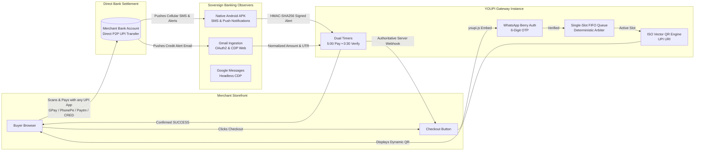

<div align="center">

```
██╗   ██╗ ██████╗ ██╗   ██╗██████╗ ██╗    ██████╗  ██████╗ 
╚██╗ ██╔╝██╔═══██╗██║   ██║██╔══██╗██║    ██╔══██╗██╔════╝ 
 ╚████╔╝ ██║   ██║██║   ██║██████╔╝██║    ██████╔╝██║  ███╗
  ╚██╔╝  ██║   ██║██║   ██║██╔═══╝ ██║    ██╔═══╝ ██║   ██║
   ██║   ╚██████╔╝╚██████╔╝██║     ██║    ██║     ╚██████╔╝
   ╚═╝    ╚═════╝  ╚═════╝  ╚═╝     ╚═╝    ╚═╝      ╚═════╝
```

#  YOUPI PG V2

### A Self-Hosted UPI Payment Gateway for Merchants


**Originally created by [Gaurav](https://github.com/gxurav1710). The project is now maintained by [Zenuxs](https://zenuxs.in).**
**0% Gateway Fees • Direct-to-Bank Settlement • WhatsApp Pre-Checkout OTP • Bank SMS & Gmail Observers**

> [!IMPORTANT]
> ## Research Project — Experimental Use Only
>
> **YOUPI PG V2 is an independent, experimental research and learning project. It is not represented as a certified, bank-approved, NPCI-approved, audited, or production-ready payment gateway.** It is published primarily for external developers to study, test, review, and contribute to.
>
> - **Appropriate scope:** local development, test environments, demos, learning, and carefully controlled experiments. Small projects or early-stage businesses may evaluate it only after independently assessing the risks and their legal/compliance obligations.
> - **Not for critical payments:** do not rely on it for essential, high-value, high-volume, time-sensitive, or business-critical transactions. Do not use it as the sole source of truth for payment confirmation.
> - **Conservative project testing limit:** for experiments, keep usage to **no more than 20 payment attempts/transactions per day per receiving account** unless you have verified the applicable bank, UPI app, and current NPCI rules and obtained any required approvals. This is a conservative project guideline, **not a claim that NPCI imposes a universal 20-transaction daily limit on every UPI account or merchant**. Applicable limits vary by transaction type, bank, app, and risk controls.
> - **No official affiliation:** this repository is not affiliated with, endorsed by, or sponsored by NPCI, RBI, any bank, or any UPI app.
> - **No compliance guarantee:** using this software does not itself authorise you to operate a payment aggregator, payment system, or other regulated service. Before accepting payments from customers or serving third-party merchants, seek qualified legal/compliance advice and confirm requirements with your bank/acquirer and the relevant authorities.
> - **Use test data where possible:** never commit bank alerts, customer information, OTPs, access tokens, API keys, webhook secrets, or other credentials. Use isolated test accounts and rotate any secret that may have been exposed.
> - **Verify every payment independently:** browser callbacks, screenshots, SMS/email parsing, and this software's status are not by themselves conclusive proof of settlement. Reconcile against the bank's official records and handle duplicates, delayed alerts, refunds, disputes, and failed payments safely.
> - **No warranty:** the software is provided for research and experimentation, without guarantees of accuracy, availability, security, compliance, or suitability for a particular purpose. You are responsible for reviewing the code and deciding whether and how to use it.
>
> Read the applicable bank terms and current official UPI requirements before any real-money use. See the [NPCI UPI FAQ](https://www.npci.org.in/what-we-do/upi/faqs) for merchant onboarding context. This notice is informational and is not legal advice.


<br/>

[](https://nodejs.org)
[](#)
[](#)
[](#)
[](#)
[](#)
[](#)
[](#)

<br/>

<p align="center">
  <a href="#-live-product-demos">Live Demos</a> •
  <a href="#-overview">Why YOUPI?</a> •
  <a href="#-architecture-at-a-glance">Architecture</a> •
  <a href="#-key-features">Superpowers</a> •
  <a href="#-step-by-step-deployment--quickstart-guide-code-deploy-kaise-kare">Deployment & Quickstart</a> •
  <a href="#-step-by-step-complete-usage-guide-use-kaise-kare">Usage Guide</a> •
  <a href="#-universal-merchant-integration">Merchant Integration</a> •
  <a href="#-tri-channel-observation-mesh">Banking Observers</a> •
  <a href="#-port-topology--microservices-map">Port Topology</a> •
  <a href="#-documentation-hub">Docs</a>
</p>

---

</div>

<br/>

##  Live Product Demos

See **YOUPI PG V2** live in action across Desktop and Mobile checkout flows:

|  Desktop Modal Flow |  Mobile Drawer & App Switcher |
| :---: | :---: |
| <br/><sub>*Full end-to-end checkout: One-script modal, WhatsApp OTP, dynamic vector QR & bank observation.*</sub> | <br/><sub>*Ultra-responsive bottom drawer with 1-tap deep-link intent for GPay, PhonePe, Paytm & CRED.*</sub> |
| • **Zero-JS One-Script Trigger**: Auto-binds to `[data-youpi-pay]`<br/>• **WhatsApp Pre-Checkout OTP**: Real-time 6-digit phone verification<br/>• **Dynamic Vector SVG QR**: Pure vector QR code with dual timers<br/>• **Experimental observer-based payment detection**: Instant credit via bank SMS/Gmail | • **Responsive Bottom Drawer**: Native app-feel mobile UI<br/>• **Direct UPI App Deep-Linking**: GPay, PhonePe, Paytm, CRED<br/>• **Real-Time Payment Polling**: Instant status reflection<br/>• **Counter Desk Modalities**: Configurable Cash & Card fallback |

<br/>

> **High-Definition 120FPS Raw Recordings**: [assets/Desktop.mp4](assets/Desktop.mp4) • [assets/Mobile.mp4](assets/Mobile.mp4)

<br/>

---

##  Overview

Traditional payment gateways (Razorpay, Cashfree, PayU, Stripe) lock your revenue into high fees, multi-day settlement delays, and sudden compliance freezes:

| Comparison Metric | Traditional Aggregators (Razorpay / Cashfree) |  YOUPI PG (Self-Hosted Sovereign) |
| :--- | :--- | :--- |
| **Transaction Fee** | **2.0% – 3.0% + 18% GST** per transaction | **0.0% (Zero Fees Forever)** |
| **Settlement Speed** | **T+2 to T+3 Business Days** (Holdbacks) | **Direct transfer; timing and availability depend on the bank and UPI rails** |
| **Account / Service Risk** | Depends on provider, bank, and circumstances | **Not eliminated**; banks can still restrict accounts and this project has no guarantee against holds or review |
| **Customer Authentication** | SMS OTP (Costly SMS gateway bills, phone spoofing) | **WhatsApp OTP** (Zero spoofing, verified mobile) |
| **Payment Verification** | Aggregator proprietary webhooks | **Bank SMS & Gmail Alerts** parsed in real time |
| **Queue & Mismatch Prevention** | Aggregator pooled virtual accounts | **Invariant Single-Slot FIFO UPI Queue** |
| **Branding Control** | "Secured by Razorpay" badges mandatory | **100% White-Label** (Your brand, your domain, zero mentions) |
| **Offline Retail Till Desk** | Expensive add-ons / dedicated POS hardware | **Built-in POS Cash & Card at Till Billing Mode** |
| **Deployment Simplicity** | Proprietary SaaS lock-in | **Native Node.js host process** (Zero Docker mandatory) |

<br/>

---

##  Architecture at a Glance

YOUPI PG is designed to use standard Indian personal or business UPI receiving accounts for payment collection by coupling **pure vector SVG QR codes** with an **automated multi-channel banking observation mesh**.



<br/>

---

##  Key Features

### 1.  No Gateway Fee in the Self-Hosted Model (Not a Reliability or Compliance Guarantee)
Every rupee paid goes straight from your customer's bank account to your bank account via standard NPCI UPI rails. This design does not itself provide regulated payment aggregation or guarantee uninterrupted access to a bank account. Confirm your intended use with your bank and qualified advisers.

### 2.  WhatsApp Pre-Checkout Authentication (Berry Protocol)
No more fake orders, bot spam, or fraudulent phone numbers. Before a customer can enter the checkout queue, the gateway delivers a cryptographically random 6-digit OTP directly to their WhatsApp app using the embedded Baileys/Berry Protocol socket. Verified customer profiles are remembered in browser `localStorage`.

### 3.  Deterministic Single-Slot FIFO Queue Engine
Because standard UPI alerts do not carry arbitrary merchant metadata, multiple concurrent transactions with identical amounts could create attribution confusion. YOUPI PG solves this with a mathematical invariant:
- **Only ONE customer can pay on a VPA at a time.**
- Other buyers wait in a database-backed FIFO queue with live position streaming.
- This queue design is intended to reduce ambiguity when matching incoming payments.

### 4.  Native Android Observer APK (`com.youpi.observer`)
A lightweight, battery-optimized Android foreground service that captures:
- Cellular banking SMS (`android.provider.Telephony.SMS_RECEIVED`).
- Real-time bank push notifications via `NotificationListenerService`.
- Enrolls securely via ephemeral QR code and signs all observation payloads with **HMAC-SHA256**.

### 5.  Automated Gmail & Google Messages Ingestion
Dual backup observation channels:
- **Gmail Observer (Port 6003):** Polls Google Cloud OAuth2 API or automated headless Chrome CDP inbox monitoring.
- **SMS Observer (Port 6002):** Connects to Google Messages for Web via Chrome DevTools Protocol (CDP).

### 6.  Dual Operational Modalities
- **Online Selling Mode:** UPI Vector QR + Cash on Delivery (COD) with customer pre-purchase verification and decoupled address lifecycle.
- **Offline Store Counter Mode:** Designed for physical retail stores. Supports UPI QR, Cash at Till (`CASH_COUNTER`), and Card at POS Terminal (`CARD_COUNTER`) with an interactive real-time cashier till dock and instant SSE customer approval.

### 7.  White-Label Configuration
Rebrand the checkout portal completely through the Merchant Admin Panel:
- Custom app name, logo URL, and browser favicon.
- Tailored color palettes, custom gradients, and trust badges.
- Custom domain binding via Cloudflare Tunnels (`pay.yourbrand.com`).
- Complete removal of any "Powered by YouPI PG" attribution.

### 8.  5 Standardized Merchant Outcome Pages
The application includes the following customer outcome pages:
- `/order-success` — Payment verified by observers, order marked paid and provisioned.
- `/order-failed` — Verification timed out, reassuring customer no money was lost.
- `/order-suspicious` — Flagged by fraud heuristics, held for manual compliance review.
- `/order-expired` — 5-minute session elapsed, slot released for queued customers.
- `/order-cancelled` — Customer cancelled checkout session.

<br/>

---

## 🛠️ Step-by-Step Deployment & Quickstart Guide (Code Deploy Kaise Kare)

Follow these simple steps to deploy **YOUPI PG V2** on your local machine, VPS, or cloud server:

### Step 1: Install System Prerequisites
Before running or deploying the code, ensure your host environment meets the following requirements:
- **Node.js**: Version `>= 22.13.0` LTS (Recommended: **Node 24 LTS**)
  - *Verify version:* `node -v`
  - *Note:* Node `>= 22.13.0` is required for native unflagged `node:sqlite` (`DatabaseSync`).
- **Git**: Installed on Linux/macOS/Windows.
- **Operating System**: Ubuntu 22.04+, Debian 12+, RHEL, macOS, or Windows 10/11 / Windows Server.
- **Docker & Docker Compose** *(Optional)*: Required only if deploying using Docker containers.

### Step 2: Clone Repository & Install Dependencies
Open your terminal or command prompt and run:
```bash
# 1. Clone the repository
git clone https://github.com/youpi-pg/YouPI-PG.git youpi-pg

# 2. Enter directory
cd youpi-pg

# 3. Install NPM dependencies across all packages and apps
npm install
```

### Step 3: Configure Environment Variables (`.env`)
Create your environment configuration file from the provided template:
```bash
cp .env.example .env
```
Open `.env` in any text editor and update the core parameters:

```env
# Master encryption key (Generate a random 64-char hex string)
ENCRYPTION_MASTER_KEY=0123456789abcdef0123456789abcdef0123456789abcdef0123456789abcdef

# JWT Secret for session authentication
JWT_SECRET=super_secret_jwt_key_at_least_32_characters_long

# Merchant Admin login credentials
INITIAL_ADMIN_EMAIL=admin@yourdomain.com
INITIAL_ADMIN_PASSWORD=YourSecurePassword123!

# Mode configuration: 'localhost' for development, or 'production' for live domain
YOUPI_MODE=localhost
YOUPI_ALLOW_LOCALHOST_MODE=true

# Public endpoint URLs
BASE_PAYMENT_API_URL=http://localhost:6100
BASE_CHECKOUT_URL=http://localhost:7000
BASE_ADMIN_URL=http://localhost:6001
```

> 💡 **Tip:** Generate a 64-character hex string for `ENCRYPTION_MASTER_KEY` using:
> `node -e "console.log(crypto.randomBytes(32).toString('hex'))"`

### Step 4: Database Setup (Zero-Config Auto-Provisioning)
YOUPI PG uses an embedded, high-performance SQLite database (`node:sqlite` in WAL mode). No external PostgreSQL or MySQL database installation is required!

On first boot, the system automatically creates `data/youpi_pg.sqlite`, executes idempotent schema migrations, and seeds default accounts.

If you want to manually initialize or reset the database at any time, run:
```bash
npm run db:setup
```

### Step 5: Choose Deployment Mode & Run

#### Mode A: Development / Demonstration Run
For local development with live reload and console logging via Control Center:
```bash
npm run dev
```
Access services at:
- **Supervisor Control Center:** [`http://localhost:8090`](http://localhost:8090)
- **Merchant Admin Panel:** [`http://localhost:6001`](http://localhost:6001)
- **Showcase Store Demo:** [`http://localhost:5000`](http://localhost:5000)
- **Payment Core REST API:** [`http://localhost:6100`](http://localhost:6100)
- **Customer Checkout Portal:** [`http://localhost:7000`](http://localhost:7000)

#### Mode B: Native Host Production Run (Linux VPS / PM2 / systemd)
For production deployment directly on a Linux server:
```bash
# Start background daemon processes
npm start

# Or using PM2 process supervisor:
npm install -g pm2
pm2 start scripts/start.js --name "youpi-pg"
pm2 save
```

#### Mode C: Docker Compose Container Deployment
If you prefer running in isolated Docker containers:
```bash
# Start all microservices in background containers
docker compose up -d

# View container status
docker compose ps

# Follow combined live logs
docker compose logs -f
```

### Step 6: Production Domain Binding & SSL (Cloudflare Tunnel / Nginx)
For public production deployment with HTTPS domain (e.g., `pay.yourdomain.com`):

1. **Option A — Cloudflare Tunnel (Recommended & Zero Open Ports):**
   ```bash
   cloudflared tunnel create youpi-gateway
   cloudflared tunnel route dns youpi-gateway pay.yourdomain.com
   ```
   Point tunnel ingress to `http://localhost:7000` (Checkout Portal proxies API calls to port `6100` automatically).
2. **Option B — Nginx Reverse Proxy:**
   Set up Nginx to proxy `https://pay.yourdomain.com` to `http://127.0.0.1:7000` with SSL certificates (Certbot / Let's Encrypt).
3. Update `BASE_PAYMENT_API_URL` and `BASE_CHECKOUT_URL` in `.env` to match your public HTTPS domain (`https://pay.yourdomain.com`).

<br/>

---

## 📖 Step-by-Step Complete Usage Guide (Use Kaise Kare)

Here is how to set up, configure, and use **YOUPI PG V2** step by step from merchant administration to storefront integration:

### Step 1: Merchant Admin Dashboard Configuration
1. Open the **Merchant Admin Panel** in your browser at `http://localhost:6001` (or your admin domain).
2. Log in using `INITIAL_ADMIN_EMAIL` and `INITIAL_ADMIN_PASSWORD` from `.env`.
3. Go to **Receiving Accounts** tab:
   - Click **Add VPA**.
   - Enter your primary bank UPI ID (e.g. `yourname@okaxis`, `business@upi`, or `9876543210@paytm`).
   - Enter Payee Name (e.g. `Acme Enterprises`).
   - Set active status to `ACTIVE`.
4. Go to **Settings / API Keys**:
   - Copy your **Merchant Public Key** (used in `youpi.js` SDK).
   - Copy your **Webhook Secret** (used to verify incoming payment notifications).

### Step 2: Set Up Banking Observers (Payment Verification Engine)
To verify payments automatically in real-time without gateway fees:

#### 1. Android Observer APK (`com.youpi.observer`):
- Locate the APK file at [`apps/android-observer-app/youpi-sms-gateway.apk`](apps/android-observer-app/youpi-sms-gateway.apk) or download directly from Merchant Admin at `/youpi-sms-gateway.apk`.
- See the dedicated [Android Observer APK Setup Guide](#-android-observer-apk-setup-guide-phone-me-download-aur-set-up-kaise-kare) below for step-by-step mobile installation and pairing instructions.

#### 2. Gmail Observer Setup:
- In Merchant Admin, navigate to **Observers -> Gmail Observer**.
- Connect your bank-linked Google Account via OAuth2 or CDP.
- The observer automatically polls official bank credit alert emails (SBI, HDFC, ICICI, Axis, Kotak, PNB, BOB, etc.).

#### 3. Google Messages Web Observer Setup:
- Navigate to **Observers -> SMS Observer**.
- Connect Google Messages for Web via Chrome DevTools Protocol (CDP) to parse bank SMS.

### Step 3: Integrate Checkout into Your Website / Storefront

#### Method 1: Zero-JS Declarative Integration (HTML Button)
Add the `youpi.js` script tag in your page `<head>`:
```html
<script src="https://pay.yourdomain.com/youpi.js" 
        data-youpi-key="YOUR_MERCHANT_PUBLIC_KEY" 
        data-currency="INR">
</script>
```
Add `data-youpi-pay` attributes to any existing HTML button:
```html
<button data-youpi-pay
        data-order-id="ORDER-1001"
        data-amount="499.00"
        data-customer-name="Mohit"
        data-customer-email="mohit@example.com"
        data-customer-phone="9876543210">
   Pay ₹499 via UPI
</button>
```
*When clicked, `youpi.js` automatically renders a dynamic checkout modal with WhatsApp OTP verification, vector QR code, and real-time payment polling!*

#### Method 2: Programmatic JavaScript API (React / Next.js / Vue / Svelte)
```javascript
window.Youpi.pay({
  order_id: 'ORDER-1001',
  amount: 499.00,
  currency: 'INR',
  customer: {
    name: 'Mohit',
    email: 'mohit@example.com',
    phone: '9876543210'
  },
  handler: function(response) {
    // Payment verified: response = { status: 'SUCCESS', order_id, utr, amount_received }
    console.log(`Payment confirmed! UTR: ${response.utr}`);
    window.location.href = `/order-success?order_id=${response.order_id}&utr=${response.utr}`;
  },
  onClose: function() {
    console.log('Customer closed payment checkout modal');
  }
});
```

### Step 4: Webhook Integration & Order Fulfillment
Set up a POST endpoint on your backend server to receive payment confirmation webhooks from YOUPI PG.

>  **SECURITY MANDATE:** Always verify the `X-Gateway-Signature` header over the **raw unparsed body bytes** before fulfilling orders!

#### Node.js (Express) Webhook Receiver Example:
```javascript
import crypto from 'node:crypto';
import express from 'express';

const app = express();

app.post('/api/youpi-webhook', express.raw({ type: 'application/json' }), (req, res) => {
  const signature = req.headers['x-gateway-signature'] || '';
  const secret = process.env.YOUPI_WEBHOOK_SECRET;
  const expected = 'sha256=' + crypto.createHmac('sha256', secret).update(req.body).digest('hex');

  if (signature.length !== expected.length || !crypto.timingSafeEqual(Buffer.from(signature), Buffer.from(expected))) {
    return res.status(401).json({ error: 'Invalid webhook signature' });
  }

  const payload = JSON.parse(req.body.toString('utf8'));

  if (payload.event === 'SUCCESS' && payload.method === 'UPI') {
    // Fulfill order in your database
    console.log(`Order ${payload.orderId} paid successfully! Bank UTR: ${payload.utr}`);
  }

  res.status(200).json({ received: true });
});
```

### Step 5: Offline Store Retail Counter / POS Mode
If operating a physical store:
1. Open **Merchant Admin -> Counter Till Dock** (`http://localhost:6001/till`).
2. Enter the bill amount and click **Generate QR**.
3. Display the counter QR code on a billing tablet or customer display.
4. Accept UPI, Cash at Counter (`CASH_COUNTER`), or Card at POS Terminal (`CARD_COUNTER`) with real-time cashier approval SSE updates.

<br/>

---

##  Universal Merchant Integration

YOUPI PG can be integrated into any website or web application using language-agnostic code:

### Polyglot Webhook Verification Snippets:

##### 1. Node.js (Express)
```javascript
import crypto from 'node:crypto';

app.post('/api/youpi-webhook', express.raw({ type: 'application/json' }), (req, res) => {
  const signature = req.headers['x-gateway-signature'] || '';
  const secret = process.env.YOUPI_WEBHOOK_SECRET;
  const expected = 'sha256=' + crypto.createHmac('sha256', secret).update(req.body).digest('hex');

  if (signature.length !== expected.length ||
      !crypto.timingSafeEqual(Buffer.from(signature), Buffer.from(expected))) {
    return res.status(401).json({ error: 'Invalid webhook signature' });
  }

  const payload = JSON.parse(req.body.toString('utf8'));
  if (payload.event === 'SUCCESS') {
    // Fulfill order: payload.orderId, payload.utr, payload.amount, payload.amountPaise
  }
  res.status(200).json({ received: true });
});
```

##### 2. Python (FastAPI)
```python
import hmac, hashlib, json
from fastapi import FastAPI, Request, HTTPException

app = FastAPI()

@app.post("/api/youpi-webhook")
async def youpi_webhook(request: Request):
    raw_body = await request.body()
    signature = request.headers.get("X-Gateway-Signature", "")
    secret = request.app.state.webhook_secret.encode("utf-8")

    expected = "sha256=" + hmac.new(secret, raw_body, hashlib.sha256).hexdigest()
    if not hmac.compare_digest(signature, expected):
        raise HTTPException(status_code=401, detail="Invalid webhook signature")

    payload = json.loads(raw_body.decode("utf-8"))
    if payload.get("event") == "SUCCESS":
        # Fulfill order: payload["orderId"], payload["utr"], payload["amount"]
        pass
    return {"received": True}
```

##### 3. PHP
```php
<?php
$rawPayload = file_get_contents('php://input');
$signature = $_SERVER['HTTP_X_GATEWAY_SIGNATURE'] ?? '';
$secret = getenv('YOUPI_WEBHOOK_SECRET');

$expected = 'sha256=' . hash_hmac('sha256', $rawPayload, $secret);

if (!hash_equals($expected, $signature)) {
    http_response_code(401);
    exit(json_encode(['error' => 'Invalid webhook signature']));
}

$payload = json_decode($rawPayload, true);
if (($payload['event'] ?? '') === 'SUCCESS') {
    // Fulfill order: $payload['orderId'], $payload['utr'], $payload['amount']
}

http_response_code(200);
echo json_encode(['received' => true]);
?>
```

##### 4. Go (`net/http`)
```go
package main

import (
	"crypto/hmac"
	"crypto/sha256"
	"encoding/hex"
	"encoding/json"
	"io"
	"net/http"
	"os"
)

func youpiWebhookHandler(w http.ResponseWriter, r *http.Request) {
	rawBody, err := io.ReadAll(r.Body)
	if err != nil {
		http.Error(w, "Cannot read body", http.StatusBadRequest)
		return
	}
	defer r.Body.Close()

	signature := r.Header.Get("X-Gateway-Signature")
	secret := []byte(os.Getenv("YOUPI_WEBHOOK_SECRET"))

	mac := hmac.New(sha256.New, secret)
	mac.Write(rawBody)
	expected := "sha256=" + hex.EncodeToString(mac.Sum(nil))

	if !hmac.Equal([]byte(signature), []byte(expected)) {
		http.Error(w, "Invalid webhook signature", http.StatusUnauthorized)
		return
	}

	var payload struct {
		Event       string `json:"event"`
		OrderId     string `json:"orderId"`
		UTR         string `json:"utr"`
		Amount      string `json:"amount"`
		AmountPaise int64  `json:"amountPaise"`
	}
	if err := json.Unmarshal(rawBody, &payload); err == nil && payload.Event == "SUCCESS" {
		// Fulfill order: payload.OrderId, payload.UTR, payload.Amount
	}

	w.WriteHeader(http.StatusOK)
	w.Write([]byte(`{"received":true}`))
}
```

<br/>

---

## 📱 Android Observer APK Setup Guide (Phone me Download aur Set Up Kaise Kare)

Follow this complete guide in **English & Hindi / Hinglish** to download, install, and pair the Android Observer APK on your mobile phone:

### 1. APK Download Kaise Kare (How to Download APK)
- **From Merchant Admin Dashboard**: Open the Merchant Admin Panel (`http://YOUR_SERVER_IP:6001` or your public domain) in your phone's browser and click the **📲 Download APK** button.
- **Direct Download URL**: Access the direct download route from any mobile browser:
  - `https://pay.yourdomain.com/youpi-sms-gateway.apk` or `http://YOUR_SERVER_IP:6100/youpi-sms-gateway.apk`
- **From Source Repository**: Transfer [`apps/android-observer-app/youpi-sms-gateway.apk`](apps/android-observer-app/youpi-sms-gateway.apk) directly to your phone via USB, WhatsApp, or Google Drive.

### 2. Mobile Phone me Install / Sideload Kaise Kare (How to Install on Phone)
1. Tap the downloaded `youpi-sms-gateway.apk` file in your browser downloads or file manager.
2. **Allow Unknown Apps**: If Android prompts *"For your security, your phone is not allowed to install unknown apps"*:
   - Tap **Settings** -> Toggle ON **Allow from this source** for Chrome/File Manager.
3. **Play Protect Warning**: If Google Play Protect shows a warning:
   - Tap **More details** -> Tap **Install anyway** (this is normal for self-hosted sideloaded research APKs).
4. Tap **Install** and open **YOUPI Observer**.

### 3. Permissions Grant Kaise Kare (Required Permissions Setup)
When you open the app for the first time, grant the required permissions:
- **SMS Permission (`RECEIVE_SMS`)**: Allows the app to read incoming bank transaction SMS.
- **Notification Access (`NotificationListenerService`)**: Allows reading bank app push credit alerts (Google Pay, PhonePe, Paytm, BHIM, Bank Apps).
- **Battery Optimization Exemption (Crucial for 24/7 Uptime)**:
  - Go to Phone **Settings -> Apps -> YOUPI Observer -> Battery / Power Management**.
  - Change setting from *Optimized / Restricted* to **Unrestricted / No Restrictions / Allow Background Activity**.

### 4. Gateway se Pair Kaise Kare (How to Pair with Gateway)
1. Open **Merchant Admin Panel** on your laptop/desktop -> Navigate to **Observers -> Android Observer**.
2. Click **Pair Device** to display the dynamic encrypted **Pairing QR Code**.
3. Open **YOUPI Observer App** on your phone and tap **Scan Pairing QR**.
4. Point your phone camera at the QR code on your computer screen.
5. **Done!** The device status turns **ACTIVE** with an encrypted **HMAC-SHA256** link. All incoming bank SMS alerts will now automatically trigger instant 0% fee payment confirmation!

---

##  Tri-Channel Observation Mesh

YOUPI PG confirms payments without expensive commercial banking APIs using a triple-layer observation pipeline:

```text
              CUSTOMER SCANS & PAYS VIA UPI
                           │
                           ▼
                 RECEIVING BANK ACCOUNT
                           │
        ┌──────────────────┼──────────────────┐
        ▼                  ▼                  ▼
┌───────────────┐  ┌───────────────┐  ┌───────────────┐
│  CELLULAR SMS │  │   BANK PUSH   │  │  GMAIL CREDIT │
│  ALERT ON SIM │  │ NOTIFICATION  │  │  ALERT EMAIL  │
└───────┬───────┘  └───────┬───────┘  └───────┬───────┘
        │                  │                  │
        ▼                  ▼                  │
┌──────────────────────────────────┐          │
│    NATIVE ANDROID OBSERVER APK   │          │
│  com.youpi.observer (Foreground) │          │
│     HMAC-SHA256 Signed Payload   │          │
└─────────────────┬────────────────┘          │
                  │                           ▼
                  │                 ┌───────────────────┐
                  │                 │   GMAIL OBSERVER  │
                  │                 │ Google Cloud API  │
                  │                 └─────────┬─────────┘
                  │                           │
                  └─────────────┬─────────────┘
                                ▼
                   PAYMENT CORE REST ENGINE
               Exact Amount & UTR Normalization
                                │
                                ▼
                       SUCCESS CONFIRMED
```

1. **Android Observer App:** Install [`apps/android-observer-app/youpi-sms-gateway.apk`](apps/android-observer-app/youpi-sms-gateway.apk) (Certified SHA-256: `959218223e75da4784744c16afaf7bc121cff377dff04f041875237042f51601`) on any secondary Android smartphone with the receiving bank SIM. Scan the pairing QR code in Merchant Admin to establish an encrypted HMAC link.
2. **Gmail Observer:** Connect your bank-registered Google account using standard OAuth2 credentials.
   <details>
   <summary><b>🔍 View Verified Indian Bank Domains & RBI <code>.bank.in</code> Registry</b></summary>

   > Supports both modern RBI-mandated sovereign `.bank.in` / `.fin.in` spaces (`sbi.bank.in`, `hdfcbank.bank.in`, `icici.bank.in`, `axis.bank.in`, `kotak.bank.in`, `pnb.bank.in`, `bankofbaroda.bank.in`, etc.) and verified legacy notification channels with full subdomain routing (`alerts.hdfcbank.net`, `custalert.icicibank.com`, `alerts.sbi.co.in`, `kotak.com`, `canarabank.com`, etc.). See [docs/OBSERVERS_SETUP.md](docs/OBSERVERS_SETUP.md) for full DNS / MX verified topology.
   </details>
3. **Google Messages Web Observer:** Pairs via headless Chrome DevTools Protocol to observe cellular SMS through Google Messages Web.

<br/>

---

## 🌐 Comprehensive Domain, Subdomain & Page Route Map (Kis Page Par Kya Hosted Hai)

YOUPI PG V2 supports both **Multi-Subdomain Hosting** (e.g. `pay.yourdomain.com`, `admin.yourdomain.com`) and **Single VPS IP / Direct Port Hosting** (e.g. `http://YOUR_VPS_IP:8090`).

### Complete Service & Page Mapping Table:

| Service Name | Port | Recommended Domain | Public Page Routes & URLs | Description |
| :--- | :---: | :--- | :--- | :--- |
| **Control Center** | `8090` | `control.yourdomain.com` | `http://YOUR_VPS_IP:8090/`<br/>`http://YOUR_VPS_IP:8090/dashboard` | Supervisor process control dashboard, live SSE log viewer & service restart panel |
| **Checkout Portal** | `7000` | `pay.yourdomain.com` | `https://pay.yourdomain.com/`<br/>`https://pay.yourdomain.com/checkout/{payment_id}`<br/>`https://pay.yourdomain.com/youpi.js`<br/>`https://pay.yourdomain.com/youpi-sms-gateway.apk` | Customer payment drawer/modal, dynamic vector UPI QR code, integration SDK, and companion Android APK download |
| **Merchant Admin** | `6001` | `admin.yourdomain.com` | `https://admin.yourdomain.com/`<br/>`https://admin.yourdomain.com/till`<br/>`https://admin.yourdomain.com/youpi-sms-gateway.apk` | Operations dashboard, VPA receiving accounts manager, API keys, branding customizer & POS Till Desk |
| **Payment REST API** | `6100` | `api.yourdomain.com` | `https://api.yourdomain.com/`<br/>`https://api.yourdomain.com/health`<br/>`https://api.yourdomain.com/api/v1/checkout/{payment_id}/state` | Core payment state engine, WhatsApp OTP gateway, observation poller & webhook dispatch engine |
| **Showcase Store** | `5000` | `store.yourdomain.com` | `https://store.yourdomain.com/`<br/>`https://store.yourdomain.com/wallet`<br/>`https://store.yourdomain.com/order-success` | Reference merchant storefront with coin wallet ledger and 5 standardized payment outcome pages |

<br/>

### Multi-Domain & Reverse Proxy Setup (Cloudflare Tunnel / Nginx Guide)

If you want to host each service on custom domains or subdomains without port numbers:

#### 1. Cloudflare Tunnel Configuration (`config.yml`):
```yaml
ingress:
  - hostname: pay.yourdomain.com
    service: http://localhost:7000
  - hostname: admin.yourdomain.com
    service: http://localhost:6001
  - hostname: api.yourdomain.com
    service: http://localhost:6100
  - hostname: control.yourdomain.com
    service: http://localhost:8090
  - hostname: store.yourdomain.com
    service: http://localhost:5000
  - service: http_status:404
```

#### 2. Nginx Reverse Proxy Configuration (`/etc/nginx/sites-available/youpi.conf`):
```nginx
# Checkout Portal (pay.yourdomain.com)
server {
    listen 80;
    server_name pay.yourdomain.com;
    location / {
        proxy_pass http://127.0.0.1:7000;
        proxy_set_header Host $host;
        proxy_set_header X-Forwarded-For $proxy_add_x_forwarded_for;
        proxy_set_header X-Forwarded-Proto $scheme;
    }
}

# Control Center Supervisor (control.yourdomain.com or http://YOUR_VPS_IP:8090)
server {
    listen 80;
    server_name control.yourdomain.com;
    location / {
        proxy_pass http://127.0.0.1:8090;
        proxy_set_header Host $host;
        proxy_set_header X-Forwarded-For $proxy_add_x_forwarded_for;
        proxy_set_header X-Forwarded-Proto $scheme;
    }
}
```

<br/>

---

##  Port Topology & Microservices Map

| Service | Port | Directory | Entrypoint | Responsibility |
| :--- | :---: | :--- | :--- | :--- |
| **Payment API** | `6100` | [`apps/payment-api`](apps/payment-api) | `src/index.js` | Core REST API, state machine, DB transactions & SSE stream |
| **Checkout Portal** | `7000` | [`apps/checkout-portal`](apps/checkout-portal) | `src/index.js` | Customer iframe checkout, dynamic vector QR, SDK bundle |
| **Merchant Admin** | `6001` | [`apps/merchant-admin`](apps/merchant-admin) | `src/index.js` | Operations panel, till billing desk, branding customizer |
| **Showcase Store** | `5000` | [`apps/coin-wallet-store`](apps/coin-wallet-store) | `src/index.js` | Reference enterprise merchant PDP, 5 outcome demonstrations |
| **Control Center** | `8090` | [`apps/control-center`](apps/control-center) | `src/index.js` | Process supervisor for starting, stopping, and logging all services |
| **SMS Observer** | `6002` | [`apps/sms-observer`](apps/sms-observer) | `src/index.js` | Google Messages Web automation via Chrome CDP |
| **Gmail Observer** | `6003` | [`apps/gmail-observer`](apps/gmail-observer) | `src/index.js` | Gmail Web CDP automation & Google OAuth2 poller |
| **Android APK** | N/A | [`apps/android-observer-app`](apps/android-observer-app) | Android OS | Intercepts cellular banking SMS and notifications |

<br/>

---

##  Security & Reliability Architecture

- **64-Bit Integer Minor Units (Paise):** Financial values are strictly represented as integers (`49900` paise = ₹499.00). Floating-point rounding drift is mathematically impossible.
- **Server-Authoritative Timers:** Timers are calculated strictly from SQLite state timestamps. Client-side browser tampering cannot manipulate countdowns.
- **Anti-Replay Observation Protection:** Android observer payloads require HMAC signatures with timestamp drift verification ($< 60$ seconds).
- **Hardware & Browser Fingerprinting:** The implementation may collect device/browser signals. Treat these as fallible risk signals, not reliable identity proof; review privacy, retention, and appeal requirements before use.
- **Write-Ahead Logging (WAL):** SQLite operates with `PRAGMA journal_mode = WAL; PRAGMA foreign_keys = ON;`, ensuring crash safety and concurrent read performance.

<br/>

---

##  Documentation Hub

Deep-dive engineering manuals and operational runbooks are available in the [`/docs`](docs) directory:

| Document | Description |
| :--- | :--- |
|  [`ARCHITECTURE.md`](ARCHITECTURE.md) | **Canonical System Architecture & Engineering Blueprint** |
|  [`docs/INSTALLATION.md`](docs/INSTALLATION.md) | Host installation, prerequisites & environment setup |
|  [`docs/DEPLOYMENT.md`](docs/DEPLOYMENT.md) | Deployment runbook & reverse proxy options |
|  [`docs/CONFIGURATION.md`](docs/CONFIGURATION.md) | Environment configuration variables & secret management |
|  [`docs/ANDROID_MOBILE_APP.md`](docs/ANDROID_MOBILE_APP.md) | Native Android Kotlin Observer APK guide & permissions |
|  [`docs/OBSERVERS_SETUP.md`](docs/OBSERVERS_SETUP.md) | Complete setup for Gmail, Google Messages & Android |
|  [`docs/MERCHANT_INTEGRATION.md`](docs/MERCHANT_INTEGRATION.md) | Full developer integration guide, SDK methods & webhooks |
|  [`docs/WHITE_LABEL.md`](docs/WHITE_LABEL.md) | White-label branding customizer, domains & Cloudflare |
|  [`docs/OPERATIONS_TROUBLESHOOTING.md`](docs/OPERATIONS_TROUBLESHOOTING.md) | Production operations, logs, diagnostics & troubleshooting |
|  [`openapi.yaml`](openapi.yaml) | Official OpenAPI 3.0 REST API specification |

<br/>

---

##  License

See [`LICENSE`](LICENSE) for the actual license terms. A license to use the code does not imply regulatory approval, bank approval, security certification, or permission to operate a regulated payment service.

<br/>

<div align="center">

### YOUPI PG 
**Self-hosted payment infrastructure with direct UPI settlement.**

⭐ **Contributions and feedback are welcome.**

</div>
